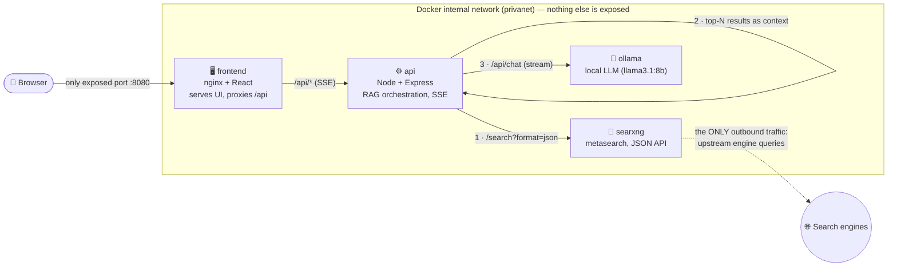

# 🔒 PrivaSearch

A **privacy-first AI search engine**. It pairs [SearXNG](https://docs.searxng.org/)
(a metasearch engine that strips trackers) with a **local LLM served by
[Ollama](https://ollama.com/)** to give you cited, synthesized answers —
**without any query, result, or answer ever leaving your machine.**

No CDNs. No Google Fonts. No analytics. No error-reporting SaaS. Everything is
self-hosted and offline-capable once the model is pulled.

---

## Architecture

**Request flow**

1. Browser posts the query to `/api/search` (same origin → nginx → API).
2. API queries **SearXNG's JSON API** and gets ranked, tracker-free results.
3. API sends the raw results back **immediately** (so they render even if the LLM is down),
   then builds a **RAG prompt** from the top N results.
4. API streams the LLM's answer token-by-token over **SSE**, with inline `[n]`
   **citations** that link to the original result URLs.

### Why Node.js + Express (not FastAPI)?

- **One language across the stack** (React frontend + API) → smaller cognitive
  and audit surface, which matters for a privacy project.
- **Node 20's built-in `fetch`** means the API needs **zero HTTP-client
  dependencies** — the only runtime dependency is Express itself. Every
  dependency is attack surface; here there is almost none.

---

