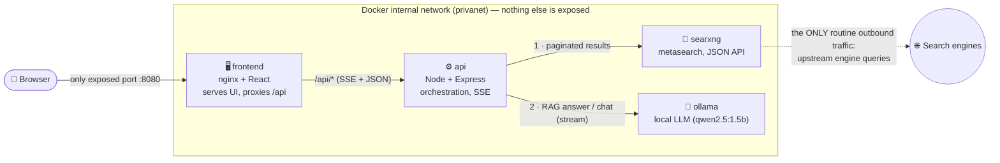

# 🔒 PrivaSearch

A **privacy-first AI search engine** you run yourself. It pairs
[SearXNG](https://docs.searxng.org/) (a metasearch engine that strips trackers)
with a **local LLM served by [Ollama](https://ollama.com/)** to give you cited,
synthesized answers — **without any query, result, or answer ever leaving your
machine.**

There is no cloud AI, no account, no query logging, and no third‑party assets.
No CDNs, no Google Fonts, no analytics, no crash reporters. Everything is
self‑hosted and offline‑capable once the model is pulled.

---

## Features

- **AI answers with real citations** — a local model synthesizes the top results
  into one answer, streamed token‑by‑token, with inline `[n]` citations that link
  back to the sources.
- **Choose how many sources** the answer considers, and **regenerate** instantly
  without re‑searching.
- **Full SearXNG results too** — categories (**All · Images · Videos · News ·
  Science · Music · IT · Files · Map**), **time / SafeSearch / language** filters,
  pagination, and an **image grid / video cards** with locally‑proxied thumbnails.
- **Per‑source “Summarize”** — stream an AI summary of any single result
  (opt‑in page fetch; can be disabled).
- **Chat tab** — a plain, private multi‑turn conversation with the local model
  (no search, wiped on reload).
- **Privacy posture panel** — live exit identity (real region, or the actual
  **Tor/VPN exit** when routed), plus a plain‑language rundown of what is and
  isn’t protected.
- **Optional Tor (free) or VPN** routing so even the upstream engines can’t see
  your IP.
- **Editorial light/dark UI** — system/serif/mono fonts only, no external assets.

---

## Architecture



**Request flow (search):** the browser fetches results from `GET /api/results`
(→ nginx → API → SearXNG JSON), then asks `POST /api/answer` to stream a RAG
answer over the top *N* of those results. Splitting the two lets you change *N*
and regenerate the answer without re‑querying the web.

### API endpoints

| Method | Path | Purpose |
|--------|------|---------|
| `GET`  | `/api/results` | Paginated raw SearXNG results (JSON) + filters |
| `POST` | `/api/answer`  | Stream a RAG answer over caller‑chosen sources |
| `POST` | `/api/chat`    | Stream a plain multi‑turn chat with the LLM |
| `POST` | `/api/summarize` | Stream an AI summary of one source |
| `GET`  | `/api/image_proxy` | Serve result thumbnails without leaking your IP |
| `GET`  | `/api/privacy` | Exit location / privacy posture (Tor‑tunnel‑aware) |
| `GET`  | `/api/health`  | Liveness + config |

### Why Node.js + Express?

- **One language across the stack** (React frontend + API) → smaller cognitive
  and audit surface, which matters for a privacy project.
- **Node’s built‑in `fetch`** means the API needs **zero HTTP‑client
  dependencies** — the only runtime dependency is Express. Every dependency is
  attack surface; here there is almost none. (Even the SOCKS client used to read
  the Tor exit is a ~60‑line, dependency‑free module.)

---

## Quick start

**Prerequisites:** Docker + Docker Compose, and Node.js (only for the one‑time
setup script). The default model needs ~1 GB of disk and a few GB of RAM.

```bash
# 1. One-time setup: creates .env and generates the SearXNG secret_key locally
npm run setup            # or: make setup

# 2. Pull the LLM into Ollama (one-time; needs internet once)
npm run pull-model       # or: make pull-model

# 3. Start everything
docker compose up -d     # or: npm run up  /  make up
```

Then open **http://localhost:8080**.

> `npm run up` / `make up` runs setup automatically, so the truly minimal path is
> `make pull-model` then `make up`.

### Helper commands

| npm | make | Does |
|-----|------|------|
| `npm run setup` | `make setup` | Generate `.env` + local settings with a random `secret_key` |
| `npm run pull-model` | `make pull-model` | Download the Ollama model |
| `npm run up` | `make up` | Setup + build + start (detached) |
| `npm run up-tor` | `make up-tor` | Same, routing search through **Tor** (free) |
| `npm run up-vpn` | `make up-vpn` | Same, routing search through a **VPN** |
| `npm run down` | `make down` | Stop and remove containers |
| `npm run logs` | `make logs` | Tail all service logs |
| `npm run tor-ip` / `vpn-ip` | `make tor-ip` / `vpn-ip` | Print the current exit IP |

---

## Configuration

All knobs live in `.env` (copied from `.env.example`):

| Variable | Default | Meaning |
|----------|---------|---------|
| `FRONTEND_PORT` | `8080` | The **only** exposed host port |
| `OLLAMA_MODEL` | `qwen2.5:1.5b` | Which local model answers |
| `LLM_TEMPERATURE` | `0.2` | Lower = more factual (RAG answers) |
| `CHAT_TEMPERATURE` | `0.6` | Creativity of the plain Chat tab |
| `RESULT_COUNT` | `5` | Default number of sources fed to the AI answer |
| `MAX_SOURCES` | `20` | Ceiling the UI can dial the source count up to |
| `ALLOW_PAGE_FETCH` | `true` | `false` → “Summarize” uses the snippet only, no page fetch |
| `SUMMARY_MAX_CHARS` | `4500` | Page text fed to the summarizer (bigger = slower on CPU) |
| `OLLAMA_KEEP_ALIVE` | `30m` | How long the model stays resident between requests |
| `SHOW_LOCATION` | `true` | `false` → no geo‑IP lookup for the exit widget |

The SearXNG `secret_key` is **not** in `.env`, and its files are **not**
committed — see [Secret handling](#secret-handling).

### Swapping the LLM model

```bash
docker compose exec ollama ollama pull mistral   # any Ollama tag
# set OLLAMA_MODEL=mistral in .env, then:
docker compose up -d api
```

### ⚡ Performance on CPU (no GPU)

The default **`qwen2.5:1.5b`** (~1 GB) is chosen for CPU: it loads in seconds and
answers in ~8 s warm. Notes:

- **Lighter/heavier:** `qwen2.5:0.5b` is faster but weaker at citations;
  `llama3.1:8b` gives the best answers but is slow on CPU (its first request
  loads ~5 GB into RAM). GPUs help a lot — uncomment the `deploy:` block for
  `ollama` in `docker-compose.yml` for NVIDIA.
- **Warm model:** it’s held in RAM for `OLLAMA_KEEP_ALIVE` (30 min) so you only
  pay the load cost once.
- If loads are extremely slow, raise Docker Desktop’s memory limit
  (Settings → Resources) to ≥ 8 GB so the model doesn’t swap.

### Pulling the model fully offline

Ollama caches weights in the `ollama-models` volume. Pull it on a connected
machine, then copy the named volume to the air‑gapped host — from then on **no
internet is required** for inference.

---

## 🛡️ Optional: hide even from the engines (Tor / VPN)

By default the only outbound traffic is SearXNG querying upstream engines from
your real IP. You can route *that* through a tunnel too.

### Free option: Tor (no account, zero setup)

```bash
make up-tor         # or: npm run up-tor
make tor-ip         # verify: prints the Tor exit IP (not yours)
```

Routes SearXNG through the Tor network via its native SOCKS proxy
(`socks5h://`, so DNS resolves through Tor too — no leak). **Trade‑offs:** slower
(3 relay hops), and some engines block Tor exit nodes (SearXNG skips those, so
you may get fewer results). Stop with `make down-tor`.

### VPN (Gluetun, 50+ providers)

Fill the **VPN block** in `.env` (examples for custom WireGuard, Mullvad, Proton,
and OpenVPN providers are in `.env.example`), then:

```bash
make up-vpn         # or: npm run up-vpn
make vpn-ip         # verify the exit IP
```

SearXNG runs *inside* Gluetun’s network namespace, and Gluetun’s **kill switch is
on by default** — if the tunnel drops, SearXNG loses all internet and searches
**fail closed** rather than leaking on your real IP.

| Provider | Set in `.env` |
|----------|---------------|
| Custom / self‑hosted WireGuard | `VPN_SERVICE_PROVIDER=custom` + the 5 `WIREGUARD_*` values |
| Mullvad | `VPN_SERVICE_PROVIDER=mullvad`, `WIREGUARD_PRIVATE_KEY`, `WIREGUARD_ADDRESSES` |
| Proton VPN | `VPN_SERVICE_PROVIDER=protonvpn`, `WIREGUARD_PRIVATE_KEY` |
| NordVPN / PIA / Surfshark | `VPN_SERVICE_PROVIDER=<name>`, `VPN_TYPE=openvpn`, `OPENVPN_USER/PASSWORD` |

> The privacy panel’s **Direct / via Tor / via VPN** buttons reflect the current
> mode and copy the right command to switch — the actual switch is a
> `make up-*` restart, because it changes the container topology (by design the
> web app has no control over Docker).

---

## 🔐 Privacy statement — what touches disk, what stays in memory

No user query, search result, or generated answer is ever sent to a third party
(the sole exception being SearXNG’s own queries to upstream engines — the
fundamental job of a metasearch engine).

**Network guarantees**

- The **only** externally‑reachable service is the frontend on `FRONTEND_PORT`.
  SearXNG, Ollama, and the API have **no published ports**.
- The **only** routine outbound traffic is SearXNG contacting upstream engines.
  With Tor/VPN enabled, even that exits through a tunnel.
- **Image thumbnails** are proxied through `/api/image_proxy`, so your browser
  **never contacts the remote image hosts** — no third‑party cookies, referrers
  or fingerprinting. SearXNG‑signed thumbnails ride the Tor/VPN egress; the API
  refuses to proxy anything that isn’t an image.
- **Opt‑in exceptions, both disableable:** clicking **Summarize** fetches that one
  page (`ALLOW_PAGE_FETCH=false` to disable); the exit‑location widget makes one
  cached geo‑IP lookup (`SHOW_LOCATION=false` to disable). Both are disclosed in
  the privacy panel.
- The UI loads **no external fonts, scripts, or stylesheets**, sends **no
  referrers**, and there is **no analytics/telemetry** of any kind.

**What touches disk**

| Data | Where | Persisted? |
|------|-------|-----------|
| Your query | API + SearXNG process memory | **No** — never written to disk |
| Search results | API process memory | **No** — held only for the request |
| Generated answer / chat | Streamed to your browser | **No** — not stored server‑side |
| LLM model weights | `ollama-models` Docker volume | **Yes** — the model files only |
| SearXNG config + secret | `searxng/settings.yml` (git‑ignored) | **Yes** — config only, no queries |

**SearXNG hardening** (see comments in `searxng/settings.yml.example`): query
logging off, debug/metrics off, no Redis/Valkey attached (nothing about a search
is persisted), `safe_search` on, public‑instance features off, autocomplete off
(no per‑keystroke leakage), remote images proxied, and a unique random
`secret_key` per install.

### Secret handling

The SearXNG `secret_key` is a high‑entropy value, so the real settings files are
**never committed**. Only the placeholder templates are tracked
(`searxng/settings.yml.example`, `settings-tor.yml.example`), and `make setup`
generates the real, git‑ignored files locally with a fresh secret — the same
pattern as `.env` / `.env.example`. To rotate the secret, delete
`searxng/settings.yml` (and `settings-tor.yml`) and re‑run `make setup`.

---

## Graceful degradation

- **LLM down / model not pulled?** Raw SearXNG results still render, with a clear
  notice that the AI answer is unavailable.
- **No results?** An explicit “no results” message instead of a hallucinated
  answer.
- **Prompt discipline:** the model is told to synthesize a single answer **only**
  from the provided results, cite each claim by index, not pad beyond the
  sources, and say *“Insufficient information in the results.”* rather than guess.

---

## Project layout

```
.
├── docker-compose.yml              # base stack (only the frontend is exposed)
├── docker-compose.tor.yml          # override: route SearXNG through Tor
├── docker-compose.vpn.yml          # override: route SearXNG through a VPN
├── .env.example                    # all configurable values
├── Makefile / package.json         # up / up-tor / up-vpn / logs / pull-model …
├── scripts/gen-secret.mjs          # cross-platform .env + settings generator
├── searxng/
│   ├── settings.yml.example        # privacy-hardened config template (JSON API on)
│   └── settings-tor.yml.example    # same, plus Tor SOCKS proxy
├── api/                            # Node + Express orchestration (SSE streaming)
│   └── src/{server,searxng,ollama,prompt,fetchPage,geo,socks}.js
└── frontend/                       # React + Vite UI, served by nginx (also /api proxy)
    └── src/{App,api}.jsx + components/{SearchBar,Answer,Results,Filters,Chat,PrivacyBadge}.jsx
```

---

## Local development (without full Docker rebuilds)

```bash
# Terminal 1 — API (needs SearXNG + Ollama reachable; easiest: keep them in Docker
# and temporarily publish their ports via a compose override)
cd api && npm install
SEARXNG_URL=http://localhost:8080 OLLAMA_URL=http://localhost:11434 npm start

# Terminal 2 — Vite dev server with hot reload (proxies /api to :3000)
cd frontend && npm install && npm run dev
```

---

## 👤 Author

**Built by [Haidar Esber](https://haidaresber.github.io)** — Lebanese software & web developer based in France.

[Portfolio](https://haidaresber.github.io) · [GitHub](https://github.com/HaidarESBER) · [LinkedIn](https://www.linkedin.com/in/haidaresber)
